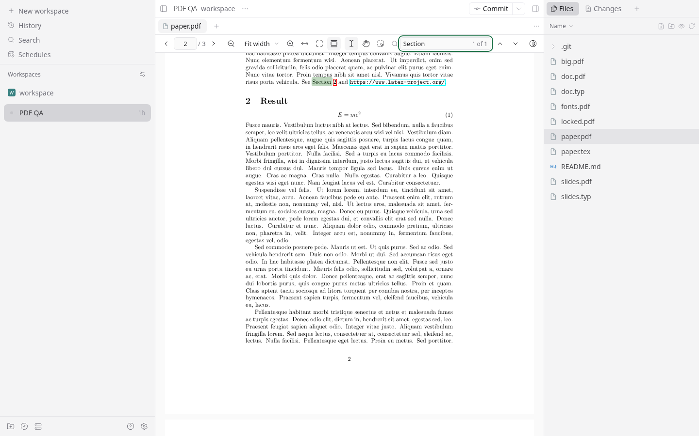

# PDF.js viewer for Paseo

A [Paseo](https://paseo.sh) plugin that opens `.pdf` files in the file tab with
[PDF.js](https://mozilla.github.io/pdf.js/): selectable text, search, links, zoom, and live reload
that keeps your place when a build rewrites the PDF. See [OVERVIEW.md](OVERVIEW.md) for what it
does from a user's point of view.



Requires Paseo 0.13.0 or later (file panels). Runs in the desktop app and the web app with
PDF.js, and on iOS with pages rendered by PDFium on the daemon; the Android app shows a message
instead.

## Install

From a checkout:

```sh
npm install            # also embeds PDF.js into server/generated/
paseo plugin install "$PWD"
```

From Git (Paseo runs the `build` steps in paseo-plugin.json on the daemon host, which needs `npm`
and `node` on its PATH):

```sh
paseo plugin add git:bendavid/paseo-pdfjs-viewer
```

Open a `.pdf` from Files. If another plugin also handles PDFs, Paseo asks which one to use; change
it later with **Open with…** in the tab menu or in **Settings › Files**.

## How it works

- **The PDF.js runtime comes from the plugin's server code.** Paseo evaluates plugin client
  bundles in the native apps too, and Hermes cannot parse PDF.js (it uses `import()`). The client
  bundle stays small (about 45 KB) and free of PDF.js; on web it asks the server for the library,
  viewer, worker, and stylesheet, and loads them from `blob:` URLs.
- **Everything is embedded at install time.** Paseo runs plugin server bundles outside the plugin
  directory, so they cannot read `node_modules` at runtime. `scripts/embed-pdfjs.mjs` writes the
  PDF.js files, CMaps, standard fonts, and image decoders into `server/generated/`.
- **Fonts and CMaps on demand.** PDF.js asks a custom `BinaryDataFactory` for each file it needs;
  the factory fetches it from the plugin's server code.
- **Scoped styles.** PDF.js's viewer stylesheet has global rules, so it is wrapped in
  `@scope (.paseo-pdfjs-root)`; browsers without `@scope` get it unscoped.
- **Reloads that keep your place.** File changes are debounced (compilers often write a PDF in
  several steps), the new version loads in a hidden layer, and the view is restored in PDF
  coordinates before the layers swap. A version that fails to parse is retried, and the old one
  stays on screen.
- **iOS renders on the daemon.** Plugins on iOS have no web view that runs scripts, so PDF.js
  cannot run there. `client/native-panel.tsx` asks the server code (`server/native.ts`) to open
  the file by its host path and to render the pages near the view. Pages show as `Image`s in a
  `ScrollView` with native pinch zoom; zooming past a whole step re-renders sharper pages. A
  rebuild re-opens the file through the same reload scheduler, keeps the reader's place as a page
  plus a fraction of it, and swaps each page's image once the new one has loaded. Renders for a
  superseded version come back `stale`, which triggers a re-open.
- **PDFium runs in a worker thread.** [`@hyzyla/pdfium`](https://www.npmjs.com/package/@hyzyla/pdfium)
  is embedded like PDF.js: `scripts/embed-pdfium.mjs` writes its CommonJS build and wasm binary
  into `server/generated/`, and `server/pdfium-host.ts` evaluates them in one worker, compiling
  the wasm once. Requests go to the worker one at a time, each with a deadline; a request past
  its deadline, a crashed worker, or a PDFium abort replaces the worker, and documents are opened
  again on demand. An idle worker is stopped after a minute. Rendering never blocks the plugin's
  own thread, so PDF.js asset requests from desktop and web are not held up, and PNG compression
  runs on Node's thread pool.
- **One render queue on the phone.** `client/render-queue.ts` runs at most two page renders at a
  time. The panel restates the pages it wants, nearest the current page first, whenever the view
  moves or an image arrives, and queued pages that are no longer wanted are dropped, so a fast
  fling costs a couple of renders. A page whose render fails waits for a new version of the file
  or a tap to retry.

## Limits

- Not available in the Android app; see the next section. On iOS there is no text selection,
  search, or links inside the document, and pages render one at a time on the daemon.
- On desktop and web, every change re-reads the whole file, because the plugin file API has no
  partial reads.
- Non-embedded Chinese, Japanese, and Korean fonts need a matching system font.
- No form filling, annotation editing, printing, or saving.

## What Paseo would need for more

- A web view with scripts, or a native PDF view, for plugins in the iOS and Android apps
  ([#5834](https://github.com/getpaseo/paseo/discussions/5834)), so PDF.js could run there with
  text selection and search. Android's web view has no PDF viewer of its own either.
- Partial reads in the plugin file API, so a rebuild does not resend the whole file.
- Saving or sharing a file to the device from a plugin.

## Develop

```sh
npm install
npm run typecheck
npm test
npm run format         # Prettier
paseo plugin install "$PWD"
paseo plugin reload pdfjs-viewer   # after changes
```

`client/web/` is the only code that touches the DOM; it is type-checked with
`tsconfig.web.json`. The rest of the client is type-checked without the DOM library and must stay
safe to evaluate in the native apps. `test/bundle.test.ts` compiles the client entry with Paseo's
compiler options and fails if PDF.js or `import()` syntax ends up in it.

## Credits

- [PDF.js](https://github.com/mozilla/pdf.js) by Mozilla renders everything. See
  [THIRD_PARTY_NOTICES.md](THIRD_PARTY_NOTICES.md).
- Paseo's [`pdf-panel`](https://github.com/getpaseo/paseo/tree/main/plugin-examples/pdf-panel)
  example is the starting point for the file panel, and the
  [`markdown-panel`](https://github.com/getpaseo/paseo/tree/main/plugin-examples/markdown-panel)
  example for mounting a DOM component on web only.
- [LaTeX Workshop](https://github.com/James-Yu/LaTeX-Workshop) and
  [vscode-pdf](https://github.com/tomoki1207/vscode-pdfviewer) showed the approach for keeping the
  reader's position across rebuilds with PDF.js. No code is copied from them.
- [getpaseo/paseo#2452](https://github.com/getpaseo/paseo/pull/2452), the earlier proposal to
  preview PDFs in Paseo core, bounded preview reads; the 64 MB prompt here follows it. The
  discussion in [#5930](https://github.com/getpaseo/paseo/discussions/5930) led to file panels.
- [tlamadon/paseo-pdf-viewer](https://github.com/tlamadon/paseo-pdf-viewer) and
  [nkwib/paseo-doc-viewer](https://github.com/nkwib/paseo-doc-viewer) informed the reading-position
  and live-reload behavior; they render with PDFium on the daemon instead, which also works on
  phones.

## License

MIT. See [LICENSE](LICENSE).
